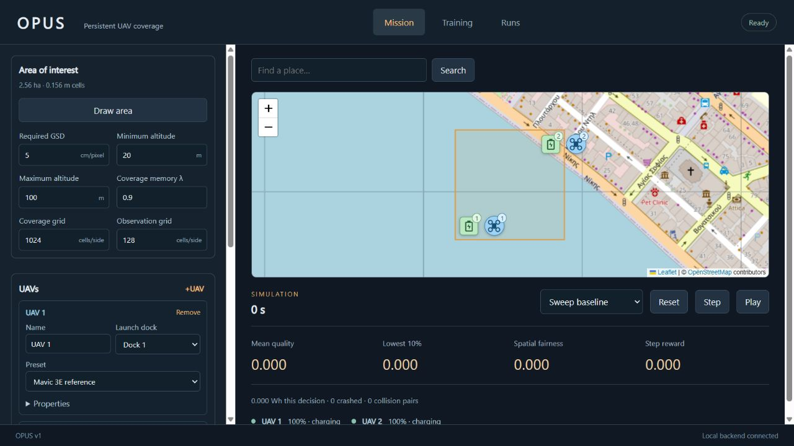

# OPUS v1

Local research application for persistent multi-UAV area scanning. It combines a Gymnasium team environment, analytical motion/energy/camera models, a deterministic recharge scheduler, a shared MAPPO actor, a centralized critic, and a browser dashboard.



*Mission setup, numbered charging docks, and persistent coverage in the local dashboard.*

## Start

The setup and launch scripts target Windows and require Git and Conda. From PowerShell:

```powershell
git clone https://github.com/aura-laboratory/OPUS.git
cd OPUS
.\setup.ps1
.\launch.cmd
```

After setup, double-click **launch.cmd** to start the Python service and open **http://127.0.0.1:8765**. Close the launcher terminal or press Ctrl+C to stop the service. The service listens on loopback only.

If the service is already running, the launcher opens the existing application. To stop a service running in the background, use `.\stop.ps1` from this directory. During training, choose **Stop & save** and wait for **Stopped** first.

From PowerShell in this directory:

```powershell
conda activate OPUS
python -m opus_rl serve
```

To recreate the isolated environment:

```powershell
.\setup.ps1
```

The isolated environment is named **OPUS**. Activate it with `conda activate OPUS`. The launcher selects it automatically through `conda run --name OPUS`. All Python dependencies are installed into that environment. Setup uses conda-forge for Python and the official CPU PyTorch wheel index; it does not change the base Conda installation. `requirements-lock.txt` records the installed package versions. After creating and activating OPUS, restore those exact versions with `python -m pip install --extra-index-url https://download.pytorch.org/whl/cpu -r requirements-lock.txt`, followed by `python -m pip install -e ".[dev]"`.

## Workflow

1. Search the map for a place. Choose **Draw area**, left-click vertices, and right-click to close the polygon. Completed vertices snap to the coverage grid when validated; the area and cell-size figures update with the mission.
2. Add each aircraft with **+UAV**. Each framed UAV entry has its own **Name**, **Preset**, and **Launch dock**, even when several aircraft use the same preset. Choose one charging-station preset and **Number of docks**, then place those numbered docks. Shared launch docks stage UAVs for sequential takeoff. Camera and energy-model settings remain under UAV **Properties**. Reference specifications and assumptions are in [PRESETS.md](docs/PRESETS.md).
3. Choose **Validate mission**. **Reset**, **Step**, and **Play** show a sweep baseline, random actions, or a loaded model. These controls do not train the actor.
4. In **Training**, set **Step time interval ΔT**, **Episode steps**, the training budget, environment count, PPO parameters, reward weights, evaluation and checkpoint intervals, and seed. **Start training** starts a local background job. **Stop & save** finishes the current calculation and writes a final checkpoint. Grid settings are in **Mission → Area of interest**.
5. **Runs** lists saved experiments. Select a checkpoint, replay it, run repeatable evaluation, or export a ZIP containing model/configuration/normalization/metrics/evaluation files.

Scenario configurations are saved with each run. The application can simulate and train without internet; map tiles and user-triggered place search require a connection. Leaflet itself is bundled locally. The application does not upload scenarios, checkpoints, or experiment data.

## Command line

```powershell
conda activate OPUS
python -m opus_rl config --output configs/default.json
python -m opus_rl train --config configs/default.json
python -m opus_rl evaluate runs/<run-id>/best.pt --episodes 3
python -m pytest -q
python -m ruff check opus_rl tests
```

`configs/learning-smoke.json` is a small, bounded learning experiment. `configs/default.json` retains the full 1024² coverage grid, 128² observation grid, 5-second decisions, λ=0.9, 20–100 m coverage altitude, 1,000-decision episodes, and agreed reward weights. Configurations also support a reduced grid for development.

## Git repository

The source repository is [aura-laboratory/OPUS](https://github.com/aura-laboratory/OPUS), with `master` as the default branch. The local checkout is connected through `origin`. A copy of the system specification is tracked under `docs/`.

```powershell
git status
git log --oneline
git diff
git pull --ff-only
git push
```

Generated runs, Conda packages, caches, and model files are excluded from Git. Export important experiments separately if you need another copy.

## Model and validation limits

v1 is an analytical research simulator. The aircraft's empirical power/acceleration defaults require calibration. A working training pipeline does not establish real-flight safety, optimal coverage, or generalization to every area and inventory. Read `docs/IMPLEMENTATION.md` for the precise motion, camera, scheduling, masking, and reward assumptions, and `docs/VALIDATION.md` for measured checks.

Load checkpoints produced by this local project only. The camera quality map represents geometric capture quality, not rendered images. Full physics, terrain, NFZs, communication failures, learned scheduling, station-placement optimization, and segment capture are future extensions.
